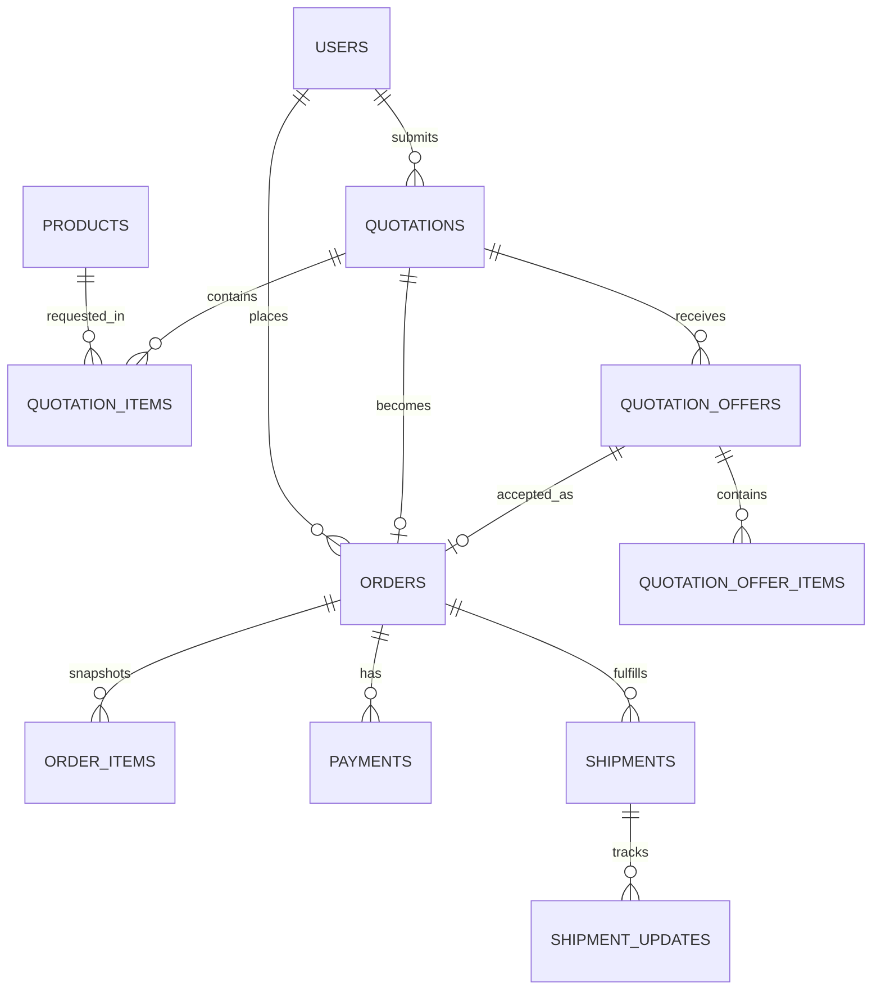

# PalmTrade — Platform Ekspor Kelapa Sawit B2B Indonesia

PalmTrade adalah platform perdagangan ekspor produk kelapa sawit premium Indonesia berbasis model *single-seller* (satu eksportir dengan multi-buyer internasional). Dibangun menggunakan Laravel, Blade, MySQL, dan custom CSS bertema **Modern Industrial Luxury**.

---

## Fitur Utama

1. **Katalog Produk Dinamis**:
   - Menampilkan produk komoditas ekspor: Crude Palm Oil (CPO), Refined Palm Oil, Palm Kernel, dan produk turunan sawit lainnya.
   - Dilengkapi spesifikasi teknis (FFA, M&I, IV, Titik Leleh), Minimum Order Quantity (MOQ), asal komoditas, dan harga indikatif (USD/MT).

2. **Permintaan Penawaran (RFQ - Request for Quotation)**:
   - Pembeli internasional dapat membuat permohonan penawaran harga dengan memilih produk, kuantitas (MT), negara dan pelabuhan tujuan, serta catatan khusus.

3. **Negosiasi & Penawaran Multi-Versi**:
   - Eksportir (Admin) dapat merespons RFQ dengan memberikan rincian harga (Incoterms FOB/CIF/CFR), ketentuan pembayaran (L/C, T/T), dan masa berlaku kuotasi.
   - Buyer dapat menerima atau mengajukan negosiasi balasan (counter-offer).

4. **Pesanan & Manajemen Pembayaran (Orders & Payments)**:
   - Transaksi otomatis dibuat setelah kuotasi disepakati.
   - Buyer dapat mengunggah bukti pembayaran (misal: Letter of Credit atau transfer bank T/T).
   - Admin dapat memverifikasi atau menolak bukti pembayaran.

5. **Pelacakan Pengiriman (Shipment Tracking)**:
   - Pelacakan status pengiriman secara real-time dari pelabuhan asal (Indonesia) ke pelabuhan tujuan dunia.
   - Riwayat pembaruan status logistik dan nomor pelacakan kapal/kontainer.

6. **Dua Workspace Berbasis Peran**:
   - **Buyer Workspace** (`/buyer/*`): Dashboard, Manajemen Permintaan Penawaran (RFQ), Pesanan, Pengiriman, dan Profil Perusahaan.
   - **Admin/Seller Workspace** (`/admin/*`): Dashboard analitik, Pengelolaan Katalog Produk, Respon RFQ, Verifikasi Pembayaran, Pembaruan Logistik/Pengiriman, dan Laporan.

---

## Skema Database & Relasi (ERD)



---

## Struktur Rute & Akses

| Area | URL / Rute | Akses |
| --- | --- | --- |
| **Publik** | `/`, `/products`, `/products/{product:slug}`, `/export-process`, `/about`, `/contact` | Publik (Semua) |
| **Autentikasi** | `/login`, `/register`, `/forgot-password`, `/reset-password/{token}` | Tamu (Guest) |
| **Workspace Buyer** | `/buyer/dashboard`, `/buyer/quotations`, `/buyer/orders`, `/buyer/shipments`, `/buyer/profile` | Buyer |
| **Workspace Admin** | `/admin/dashboard`, `/admin/products`, `/admin/quotations`, `/admin/orders`, `/admin/payments`, `/admin/shipments`, `/admin/buyers`, `/admin/reports` | Admin / Seller |

---

## Akun Demo untuk Pengujian

Aplikasi telah dilengkapi seeder data demo:

| Peran (Role) | Email | Password | Keterangan |
| --- | --- | --- | --- |
| **Admin / Seller** | `admin@palmtrade.com` | `password` | Akun pengelola eksportir |
| **Buyer Internasional** | `buyer@globaloil.com` | `password` | Akun pembeli luar negeri |

---

## Panduan Instalasi & Menjalankan Aplikasi

1. **Clone repositori dan install dependency**:
   ```bash
   composer install
   npm install
   ```

2. **Konfigurasi Environment (`.env`)**:
   Salin berkas `.env.example` ke `.env` lalu sesuaikan konfigurasi database:
   ```env
   APP_NAME="PalmTrade"
   APP_URL=http://127.0.0.1:8000

   DB_CONNECTION=mysql
   DB_HOST=127.0.0.1
   DB_PORT=3306
   DB_DATABASE=palmtrade
   DB_USERNAME=root
   DB_PASSWORD=
   ```

3. **Generate App Key**:
   ```bash
   php artisan key:generate
   ```

4. **Jalankan Migrasi & Database Seeder**:
   ```bash
   php artisan migrate:fresh --seed
   ```

5. **Jalankan Server Lokal**:
   ```bash
   php artisan serve
   ```
   Buka peramban pada alamat `http://127.0.0.1:8000`.

---

## Design System & Identitas Visual

- **Forest Green** (`#123C2E`): Warna utama korporat dan latar permukaan gelap.
- **Primary Green** (`#1D5B43`): Tombol aksi utama dan aksen interaktif.
- **Warm Ivory** (`#F7F5EF`): Latar belakang editorial yang elegan.
- **Accent Brass** (`#B89455`): Aksen kemewahan industri untuk badge dan penanda penting.
- **Charcoal** (`#202923`): Tipografi teks utama.
- **Subtle Border** (`#E4E7DF`): Pembatas dan garis kartu yang bersih dan rapi.
